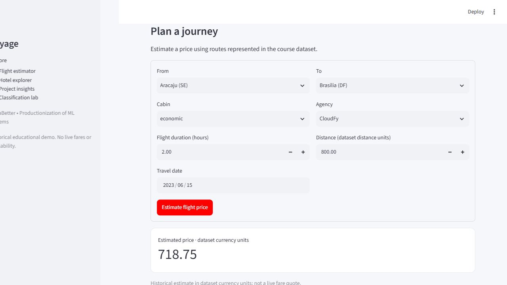
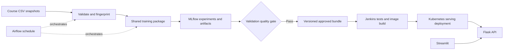

# Voyage Analytics — Travel Prediction and MLOps Platform

An individual AlmaBetter **Productionization of ML Systems** capstone by **techysuman27**. The application estimates historical flight prices, recommends hotel/destination options, and includes an educational classification benchmark. Shared model code connects three assessed notebooks to a Flask API, Streamlit UI and repeatable MLOps workflows.

**Repository:** https://github.com/techysuman27/MLOps-Travel-App  
**Public demo:** deployment pending account connection; no public URL is claimed yet.  
**Verification status:** [evidence ledger](docs/verification.md).



## Measured results

These are historical held-out results, not accuracy guarantees for live travel markets.

| Task | Selected model | Final held-out result | Interpretation |
|---|---|---|---|
| Flight regression | Histogram gradient boosting, 200 iterations | MAE **5.75**, RMSE **7.69**, R² **0.99955** | Constrained historical catalogue; currency is unspecified |
| Source-label classification | Depth-limited random forest | Accuracy **35.32%**, macro F1 **0.3512** | Weak predictive value; not a person's identity |
| Hotel recommendation | Frequency/similarity hybrid, alpha=1 | Recall@3 **0.3783**, NDCG@3 **0.7236** | Popularity baseline: Recall@3 0.3467, NDCG@3 0.6966 |

Full candidate comparisons, split details, limitations and provenance are in [reports](reports). The classifier retains `none` as an undocumented source category, excludes personal names and user identifiers, and is not used to set prices or recommendations. The recommendation catalogue contains **nine hotels, exactly one per destination**; selecting a city therefore becomes a catalogue lookup.

## Architecture



The fitted preprocessing pipeline travels with the estimator. API startup verifies artifact checksums; missing models fail readiness. Training and serving do not maintain competing feature implementations. Scheduled candidates stay separate from the deployed release. See the [architecture design](docs/architecture_proposal.md).

## Project layout

```text
notebooks/             Three modeling submissions with executed outputs
src/voyage/            Validation, splitting, features, training and inference helpers
api/                   Flask application factory and request contracts
app/                   Streamlit application
models/                Approved bundles, candidates and version manifests
reports/               Measured evaluation and data reports
docker/                API, UI, training and Airflow images
kubernetes/            Deployment, Service and optional HPA
airflow/dags/          Scheduled regression lifecycle
scripts/               Data download, checks, notebooks and bounded load test
tests/                 Contract, serialization, inference and recommendation tests
docs/                  Architecture, verification, workflow and video notes
Jenkinsfile            Test, build, verify, publish and deploy pipeline
compose.yaml           Local application and optional operational services
render.yaml            Free-tier API deployment definition
```

## Run locally

Use Python 3.13 (3.12 is also supported by the source), Git and a project-local environment. On Windows PowerShell:

```powershell
git clone https://github.com/techysuman27/MLOps-Travel-App.git
cd MLOps-Travel-App
python -m venv .venv
.\.venv\Scripts\python.exe -m pip install -r requirements.txt
.\.venv\Scripts\python.exe -m pip install --no-deps .
.\.venv\Scripts\python.exe -m api.app
```

In a second terminal:

```powershell
.\.venv\Scripts\python.exe -m streamlit run app/streamlit_app.py
```

Open http://localhost:8501. The local API defaults to http://127.0.0.1:8000. On Linux/macOS, use `.venv/bin/python` instead. The checked-in model bundles allow inference without downloading the raw course data. Only load this project's trusted artifacts; joblib is a Python serialization format.

### Reproduce modeling

```powershell
.\.venv\Scripts\python.exe scripts/download_data.py
.\.venv\Scripts\python.exe -m voyage.cli validate
.\.venv\Scripts\python.exe -m voyage.cli metadata
$env:OMP_NUM_THREADS='4'
.\.venv\Scripts\python.exe -m voyage.cli train --task all
.\.venv\Scripts\python.exe -m voyage.cli promote --task all
```

Training saves immutable run directories and separate candidate manifests. Promotion checks the gate and checksum before updating the local approved pointer. Restart the API to serve a new approved release. The regression gate requires validation RMSE at least 10% below the median baseline. The classification gate permits an explicitly educational benchmark, not a business-grade classifier. Recommendation selection includes popularity as an eligible fallback.

Data comes from [the course archive](https://drive.google.com/file/d/1fd21ljY3KS3B6ZPITmSlDHVD2yff46OC/view). Raw CSVs are excluded from Git; [source fingerprints](reports/source_validation.json) identify the downloaded snapshot. The source has 271,888 flights, 40,552 hotel bookings and 1,340 users. The shared template is preserved in `templates/` for reference.

### Colab notebooks

- [Flight price regression](https://colab.research.google.com/github/techysuman27/MLOps-Travel-App/blob/main/notebooks/01_Flight_Price_Regression.ipynb)
- [Educational label classification](https://colab.research.google.com/github/techysuman27/MLOps-Travel-App/blob/main/notebooks/02_Gender_Label_Classification.ipynb)
- [Hotel recommendation](https://colab.research.google.com/github/techysuman27/MLOps-Travel-App/blob/main/notebooks/03_Hotel_Recommendation.ipynb)

Each follows the eight main template sections, contains fifteen exploration charts, exploratory hypothesis checks, model comparisons, interpretation and artifact verification. Saved execution reuses the measured report; set `REBUILD_MODELS=True` in the modeling cell for fresh training. The Colab bootstrap downloads data when absent. Do not use repeated test inspection to tune candidates.

## API examples

```bash
curl http://localhost:8000/health/ready
curl -X POST http://localhost:8000/api/v1/flights/predict \
  -H 'Content-Type: application/json' \
  -d '{"from":"Recife (PE)","to":"Florianopolis (SC)","flightType":"firstClass","agency":"FlyingDrops","time":1.76,"distance":676.53,"date":"2023-06-15"}'
curl -X POST http://localhost:8000/api/v1/hotels/recommend \
  -H 'Content-Type: application/json' -d '{"user_code":0,"k":3,"budget":500}'
```

| Endpoint | Purpose |
|---|---|
| `GET /health/live` | Process responsiveness |
| `GET /health/ready` | All required artifacts loaded; otherwise HTTP 503 |
| `GET /api/v1/model-info` | Versions, measured metrics and limitations |
| `GET /api/v1/catalogue` | Non-name catalogue and aggregate metadata |
| `POST /api/v1/flights/predict` | Validated flight estimate |
| `POST /api/v1/classification/predict` | Educational source-label benchmark using company and age |
| `POST /api/v1/hotels/recommend` | Budget/destination/history-aware suggestions |

Invalid requests return structured errors. Predictions carry model versions and request IDs. Logs capture path, status and latency without raw personal request payloads.

## Verification

```powershell
.\.venv\Scripts\python.exe -m pytest -q
.\.venv\Scripts\python.exe scripts/smoke_test.py
.\.venv\Scripts\python.exe scripts/execute_notebooks.py
.\.venv\Scripts\python.exe scripts/monitor_data.py
```

Tests cover trip separation, serialization parity, corrupted artifacts, failed promotion preserving the current release, readiness failure, malformed inputs, unknown categories, real inference and recommendation cold starts. The smoke test exercises actual HTTP predictions rather than only opening a page. `monitor_data.py` compares historical distributions; it does not measure live drift or accuracy without labels.

## Docker and MLflow

Copy `.env.example` to `.env` and replace its database password with a local random value. Do not commit `.env`. Stop local processes occupying 8000/8501 before starting Compose.

```bash
docker compose up --build -d api ui
docker compose ps
docker compose --profile ops up --build -d mlflow postgres airflow
```

The API binds locally on 8000, UI on 8501, MLflow on 5000 and Airflow on 8080. The operational profile uses PostgreSQL for Airflow and an isolated model-training environment. On a 4 GB Docker allocation, run Kubernetes and the operational services separately to avoid resource pressure.

Local Python training defaults to `sqlite:///mlflow.db`. View those local experiments with:

```powershell
.\.venv\Scripts\python.exe -m mlflow server --backend-store-uri sqlite:///mlflow.db --host 127.0.0.1 --port 5000
```

The Compose MLflow service has its own persistent tracking volume. Set `MLFLOW_TRACKING_URI=http://127.0.0.1:5000` for host training against that server; scheduled container tasks use `http://mlflow:5000`. Do not mix up the two stores when gathering screenshots.

## Kubernetes

The manifests assume a local image named `voyage-api:local`. For a kind cluster named `voyage`:

```bash
docker build -f docker/Dockerfile.api -t voyage-api:local .
kind load docker-image voyage-api:local --name voyage
kubectl apply -f kubernetes/deployment.yml
kubectl -n voyage rollout status deployment/voyage-api
kubectl -n voyage port-forward service/voyage-api 18080:80
```

Run the smoke test with `--url http://127.0.0.1:18080`. The two replicas have resource budgets and startup/readiness/liveness probes. Manual scaling can be demonstrated with `kubectl -n voyage scale deployment/voyage-api --replicas=3`. The optional HPA requires a working metrics-server; do not claim autoscaling from the YAML alone. A bounded test is available in `scripts/load_test.py`. For a published release, `scripts/render_deployment.py` requires an immutable registry digest.

If using the project-local kind configuration, prefix commands with the appropriate `--kubeconfig artifacts-local/kubeconfig`. Keep that file private.

## Airflow and Jenkins

`voyage_regression_lifecycle` schedules weekly at 02:00 UTC on Sundays, with catch-up disabled and one active run. It validates sources, trains/compares/evaluates regression candidates, then gates approval. The fixed historical data demonstrates orchestration; it is not a live feed. Each logical run writes its own candidate folder. The deployed model does not change just because a DAG ran.

The Jenkinsfile needs a Linux agent with Python 3.13, Docker and kubectl. It installs the package, runs tests, builds an API image and verifies real container predictions. Publishing/deployment are explicit parameters. Configure `voyage-registry` as username/password credentials and `voyage-kubeconfig` as a secret file for deployment. No credentials belong in the repository. A scheduled candidate must be deliberately selected into a reviewed release before this pipeline runs; the initial integration is a controlled handoff, not an automatic Airflow-to-Jenkins trigger.

## Free public demo

The planned demo uses Render's free web service for the API and Streamlit Community Cloud for the UI. Deploy the `render.yaml` blueprint from your own account, then configure the actual API URL for the Streamlit application. These account-authorized deployments are pending. Free Render instances may sleep after inactivity and cannot demonstrate Kubernetes autoscaling; cluster evidence is recorded separately.

Current platform documentation: [Render free services](https://render.com/docs/free), [Streamlit Community Cloud](https://docs.streamlit.io/deploy/streamlit-community-cloud). Do not present the demo as a production SLA-backed service.

## Submission and recording

See [workflow narrative](docs/workflow.md), [verification ledger](docs/verification.md), and [recording outline](docs/video_walkthrough.md). The pasted course rules conflict between 15-minute and 40-minute minimums; prepare 40–45 minutes unless the mentor confirms otherwise. The video should focus on the regression lifecycle while the repository and notebooks cover all three tasks.
