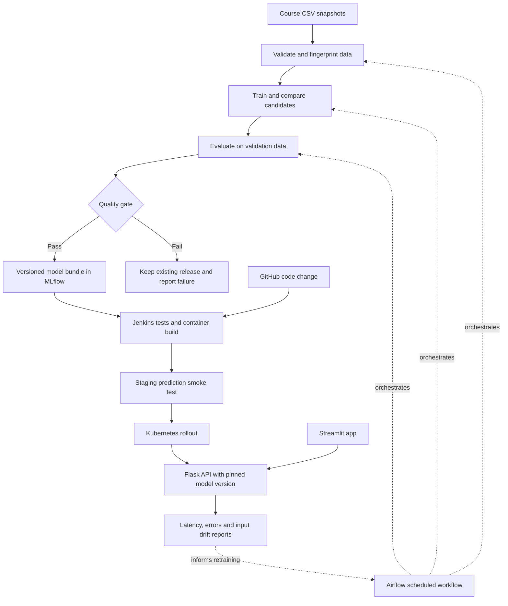

# Voyage Analytics: proposed architecture

Status: historical design proposal, written before implementation. For the implemented system, diagram and sequential build guide, read [architecture walkthrough](architecture_walkthrough.md). Current execution evidence is recorded in [verification ledger](verification.md). The plans below are not proof that every proposed capability was executed.

## Design goal

Deliver a small, coherent ML product whose complete regression lifecycle can be demonstrated and explained by one student. Use one repository, one shared Python package, a Flask inference service, and a Streamlit interface. Separate training from serving. Include every required MLOps tool with a verifiable responsibility; avoid additional services without a demonstrated need.

## System flow



The gate selects a candidate; it does not automatically overwrite a live model. A release identifies a Git commit, dataset fingerprint, MLflow run, model artifact checksum, and container digest. Jenkins releases that exact combination. The final test set remains untouched by tuning and routine candidate selection.

## Components and responsibilities

| Component | Responsibility | Demonstrable evidence |
|---|---|---|
| Three Colab notebooks | Explain EDA, preprocessing, model comparisons and evaluation using shared training code | Executed cells, figures, reasoned interpretation, summaries and repository link |
| Shared Python package | Validate data, transform features, train, evaluate, serialize and infer | Unit tests and saved-model prediction parity |
| Flask | Serve flight predictions, the educational classifier and hotel recommendations | Valid request, invalid request, versioned response and missing-model readiness failure |
| Streamlit | Flight estimator, hotel explorer and evaluation insights | Public URL, actual API predictions and clear dataset limitations |
| MLflow | Record parameters, metrics, data/code versions and complete model bundles | Comparable runs and traceable selected model |
| Airflow | Orchestrate validation, training, evaluation and candidate registration | Successful scheduled DAG and failure-path demonstration |
| Jenkins | Test code, verify artifacts, build immutable images, test staging, deploy and verify rollout | Build log showing enforced tests and release identity |
| Docker | Reproduce application and service environments | Working containers with health checks |
| Kubernetes | Run serving replicas, route traffic, check readiness and demonstrate scaling | Ready pods, successful rollout, scaling evidence and rollback procedure |

## Modeling decisions

### Flight price regression

Use origin, destination, cabin, agency, duration, distance and derived calendar features where known at request time. Exclude user/trip identifiers and price-derived inputs. Document the meaning of the source date and avoid inventing booking lead time, currency, or live fare availability.

Compare a dummy baseline, a regularized linear model, and tree-based candidates with bounded tuning. Keep preprocessing inside the fitted pipeline. Use chronological training, validation and final test periods. Purge trips spanning split boundaries so outbound/return records do not cross partitions; report excluded counts and actual split sizes. Fit transformations within each training fold. Select models on validation performance, then evaluate the selected model once on the final holdout.

Report MAE, RMSE and R-squared, plus errors by route and cabin with sample counts. Record fitting and inference time. A strong result must also beat the baseline and serve within a measured latency budget. Set practical thresholds after baseline measurement and before candidate promotion; do not invent an accuracy target now.

### Educational gender-label classification

Keep the dataset's `none` label explicit as an undocumented source category; never relabel it as a gender identity. Begin with a three-label benchmark and explain its semantics. Use user-level stratified partitions, exclude identifier code, and compare dummy, linear and tree-based classifiers. Fit any encoders, imputers or text transforms only on training data.

Start with company and age to establish predictive limits. Any optional name-based experiment must be separately documented, tested on unseen names, and presented as dataset-label prediction with limitations. No use of predicted gender in recommendations, pricing or access decisions. Report macro F1, per-label precision/recall, balanced accuracy, confusion matrix and baseline comparison. Low performance is a legitimate result; do not claim this predicts a person's identity.

### Hotel recommendation

Our audit confirms nine hotels and exactly one hotel per destination. Rank hotel-and-destination options across the available catalogue, with optional budget/destination filters. A fixed destination can return only its recorded hotel; show that honestly and distinguish catalogue lookup from personalized ranking. Do not manufacture hotel inventory, ratings, amenities or current availability.

Compare global booking popularity, personal booking-frequency preference, and a small hybrid using implicit interaction similarity plus explicit budget/destination preferences. Interpret repeated bookings as implicit evidence, not satisfaction ratings. Retain repeat-booking candidates because revisiting a hotel is plausible. Construct histories only from training-period events; use a global chronological cutoff for future validation/test events. State candidate eligibility, cold-start handling and catalogue coverage. Report Recall@3, NDCG@3 and coverage against the popularity baseline; with nine items, top-five metrics alone can be misleading. Evaluate unfiltered ranking separately from destination-filtered retrieval.

## Serving and UI contracts

- Flask application factory loads verified model bundles at startup under both local and production servers. No training at import time or during requests.
- Endpoints: `POST /api/v1/flights/predict`, `POST /api/v1/classification/predict`, `POST /api/v1/hotels/recommend`, `GET /health/live`, `GET /health/ready`, and `GET /api/v1/model-info`.
- Validate types, required fields, numeric ranges and supported categories. Return structured client errors; never silently convert an unknown city into a known one.
- Responses contain predictions/recommendations, model version and request ID. Explain that prices are estimates in dataset units until currency is verified.
- Liveness checks process responsiveness; readiness checks artifact loading and inference readiness and returns 503 if the service cannot predict.
- Streamlit uses the API for model results; it does not duplicate feature transformations or fit models on reruns. Use a compact demonstration dataset without personal names for public insights.
- Explain recommendations using observed signals such as past bookings or budget fit, without presenting those reasons as causal explanations.

## Automation and artifact flow

Airflow tasks call the same installed package as notebooks and CLI commands. DAG parsing performs no data loading or training. Each run writes immutable outputs under its run ID, then passes small artifact references between tasks. Retries must not corrupt the previous release. Data validation failure stops training; model quality failure stops registration/promotion. With a fixed historical dataset, scheduled runs demonstrate orchestration and detect unchanged data; they do not imply a live travel feed.

Jenkins runs real tests and fails on failures. Test artifact loading and preprocessing parity, malformed requests, missing-model readiness, unseen categories, recommendation cold starts, and recommendation filtering. Start the built container and call a prediction endpoint before pushing/deploying. Routine code CI uses small fixtures; full retraining is an explicit workflow. Integration can initially pass a selected model run ID to a parameterized release build, with automatic triggering added after both workflows are independently verified.

Keep a model manifest next to the complete joblib pipeline. Bake the approved bundle into the serving image for this capstone so replicas do not depend on a mutable shared model directory. Pin images by digest/release identity and retain the previous release for rollback. A model-only release still runs the same compatibility and serving checks.

## Deployment plan

Use Docker Compose for reproducible local API, UI, MLflow, Airflow and PostgreSQL services. Run the operational services as needed to fit the student's computer. Use a Linux container environment for Airflow. Keep Jenkins' agent configuration explicit and reproducible.

For Kubernetes, begin with two Flask replicas, resource requests/limits and separate liveness/readiness probes. Demonstrate a controlled load test and an HPA after installing/verifying its metrics dependency. Record observed replicas and latency rather than merely showing YAML. Use a small cluster suitable for the available machine or hosting account; resource allocations follow measurement.

Publish the Streamlit app and Flask service behind HTTPS. Hosting provider, account access and budget remain unresolved; avoid committing to a paid cluster before these are known. Public app hosting and a local Kubernetes demonstration can be separate only if course expectations allow it, and the documentation must state where each runs. Keep Jenkins, Airflow and MLflow administration private.

## Monitoring

Record request count, latency, errors and model version without names or raw personal payloads. Produce a scheduled drift report against training distributions. Operational metrics are available immediately; prediction accuracy requires actual later outcomes. Do not label an unlabeled drift score as accuracy. Provide a controlled drift example and explicitly label demonstration data.

## Repository structure

```text
notebooks/                 # Three assessed modeling narratives
src/voyage/
  data/                    # Contracts, joins, fingerprints and splits
  features/                # Shared deterministic transforms
  training/                # Candidate fitting, evaluation and tracking
  inference/               # Bundle loading and model services
  monitoring/              # Drift and service reports
api/                       # Flask factory, routes and validation
app/                       # Streamlit pages
configs/                   # Training and release configuration
models/                    # Approved artifacts and manifests
data/raw/                  # Locally downloaded source CSVs, ignored by Git
docker/                    # Images and Compose services
kubernetes/                # Deployment, Service, HPA and configuration
airflow/dags/              # Regression lifecycle orchestration
tests/                     # Unit, contract and integration checks
scripts/                   # Data retrieval, training and demo commands
docs/                      # Architecture, model cards, evidence and video script
Jenkinsfile
requirements.txt
pyproject.toml
README.md
```

Keep reference source outside this repository. Store no credentials, Airflow databases, runtime logs or copied model binaries in Git. Use real incremental commits as work progresses.

## Build sequence and acceptance

1. Data contracts and splitting: reproduce audits, validate joins and test trip separation.
2. Regression vertical slice: train, track, serialize, serve and test a prediction through Streamlit.
3. Classification and recommendation: complete honest baselines, independent evaluation and three executable notebooks in template format.
4. Containers: reproduce local UI/API behavior and preserve tracking artifacts across restarts.
5. Airflow and Jenkins: demonstrate a successful run and a rejected candidate/build, then connect release identities.
6. Kubernetes and public hosting: verify rollout, readiness, prediction, scaling and rollback; check public access from a separate session.
7. Submission evidence: original screenshots, Google Docs workflow narrative, repository README, viewable Drive files and regression-focused recording script.

Do not describe the architecture as production-ready until its relevant failure modes and operational checks are actually demonstrated. The intended improvement over the references is measured reliability and reproducibility; predictive improvement remains an empirical question.
