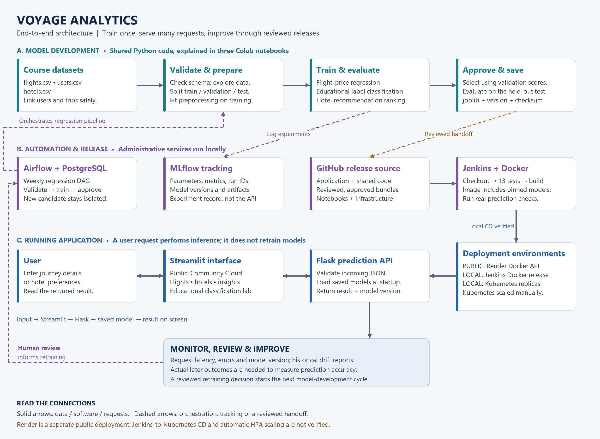

# Voyage Analytics — architecture and build order

[Download the diagram as PDF](diagrams/voyage-architecture.pdf)

The architecture has three connected activities: teaching models from historical data, packaging and releasing the application, and answering user requests. Training happens before serving. Opening the website does not start Airflow or retrain a model.

## Build the project in this order

1. **Define the product and create the repository.** Decide what goes in and what comes out: journey details produce a historical fare estimate; booking history and preferences produce hotel suggestions; age/company support an educational source-label experiment. Create the GitHub repository and separate folders for data handling, shared model code, notebooks, API, interface, tests and deployment. Commit meaningful changes throughout development.

2. **Obtain and understand the three datasets.** Inspect flights, users and hotels. Check what every column means. Users connect through userCode; travelCode identifies trips. A trip has multiple flight rows, so a careless join can duplicate hotel spending. Do not assume currency, booking lead time, ratings or live availability that the source does not provide.

3. **Validate and explore the data.** Check missing values, duplicates, invalid values, dates and user references. Explore prices, routes, cabins and booking patterns. Keep reproducible validation in the shared Python package and explain the findings in the three notebooks. Save a fingerprint of the source files so a model can be traced to the data used.

4. **Create honest train, validation and test splits.** Training is practice; validation helps choose between approaches; the final test is the unseen examination. Flight and hotel events use time-based splits. Classification uses separate users with similar label proportions across partitions. Do not fit encoders or scalers on the final test data. Flight trips that cross a split boundary must not leak across partitions.

5. **Train simple baselines and better candidates.** Compare median pricing, Ridge and gradient boosting for flights. Compare majority, logistic regression and random forest classification. Compare hotel popularity with personalized ranking. Put preprocessing and model logic in shared code so notebooks, Airflow and Flask do not contain competing implementations. Start MLflow tracking here: it records each experiment as it happens.

6. **Choose, evaluate and approve the model.** Select using validation results; evaluate the selected approach on the final test. For flights, use MAE, RMSE and R-squared. For classification, include macro F1 and per-label results. For hotels, use Recall@3 and NDCG@3. The flight gate requires validation RMSE at least 10% better than the median baseline. The classification result is a weak educational benchmark, not a useful identity prediction service.

7. **Save a complete prediction artifact.** Save the fitted preprocessing and model together as a joblib bundle, plus a manifest containing its version and checksum. Think of it as a trained machine with its operating instructions attached. MLflow retains experiment/model records; the application loads its approved local bundle. It does not ask MLflow to select a new winner whenever a request arrives.

8. **Build and test the Flask API.** The API is the doorway into the trained model. It accepts JSON, validates the request, applies the saved pipeline and returns the result with a model version. Test valid requests, bad inputs, missing artifacts and prediction consistency. Separate liveness ('the process responds') from readiness ('the models are loaded and usable'). Verify this before building the interface.

9. **Build the Streamlit interface.** Add forms for journeys and preferences, result displays and evaluation insights. When the user clicks a button, Streamlit calls Flask. Flask predicts and sends back JSON; Streamlit turns it into a readable screen. No retraining occurs during this interaction.

10. **Package and check the application with Docker.** An image packages code, dependencies and the approved model into a reproducible runnable environment. Test the actual running image, not just Python outside the container. In this project, a missing artifact dependency was caught and fixed during container readiness testing.

11. **Deploy and demonstrate scaling.** Host the public Flask image on Render and the public interface on Streamlit Community Cloud; point the interface at the API URL. Separately, deploy API replicas in the local Kubernetes cluster. Kubernetes probes identify usable replicas and a Service provides a stable endpoint. The project verified two ready replicas and manual scaling to three. Public Render hosting is not the local Kubernetes cluster.

12. **Automate application checks and local release with Jenkins.** Once a manual release works, encode the repeatable steps: get the GitHub revision, run tests, build the Docker image, start it, check real predictions, and deploy it if enabled. Build 3 verified this flow through a persistent local Docker API. Registry publishing and Kubernetes CD exist as optional stages but were not executed. A pipeline build was explicitly triggered; do not imply that a GitHub webhook was verified.

13. **Automate regression retraining with Airflow.** After manual training works, make a DAG with ordered tasks: validate sources, train/evaluate, then approve the candidate if it passes. PostgreSQL stores Airflow's workflow state. The DAG calls the shared training code and logs to MLflow. Its weekly schedule is configured; the successful demonstrated run was manually triggered. Candidate files remain separate from the public release. A person reviews and selects the candidate for a subsequent software release.

14. **Monitor, review and improve.** Watch response times, errors and model versions. Compare data distributions with training data; the current drift report is historical, not a continuously running live detector. Actual later prices or bookings are needed to measure real predictive quality. Review new evidence, decide whether retraining is justified, and repeat the training/approval/release cycle. Monitoring does not automatically trigger retraining in this implementation.

## One user request, from beginning to end

A visitor enters an origin, destination, cabin, agency, duration, distance and date in Streamlit. Streamlit sends those values to Flask over HTTP. Flask validates them, passes them through the already fitted preprocessing and flight model, and returns a price estimate, model version and request ID. Streamlit displays the estimate and its limitations. The API logs operational information. Docker supplies the running environment; the hosting service keeps it available. Training tools are not involved in the request path.

## Why the automation tools are different

| Tool | Plain-language role | What it connects |
|---|---|---|
| GitHub | Project history and release source | Code, notebooks, approved bundles and infrastructure |
| MLflow | Experiment diary and model record | Training runs to parameters, metrics and artifacts |
| Flask | Model's service doorway | Incoming requests to saved predictions |
| Streamlit | User-facing screen | People to Flask requests and results |
| Docker | Reproducible application package | Code, dependencies and model files to a runnable container |
| Kubernetes | Manager of multiple running copies | Deployment configuration to ready API replicas |
| Jenkins | Software testing and release assistant | GitHub revision to tested image and enabled deployment |
| Airflow | Ordered training-work scheduler | Source validation to retraining and candidate approval |

The practical build order is: a correct manual model, a correct manual API, a usable interface, a reproducible container, a working deployment, and then automation around those proven steps. MLflow belongs alongside model experimentation from the start, and GitHub belongs throughout the project.
