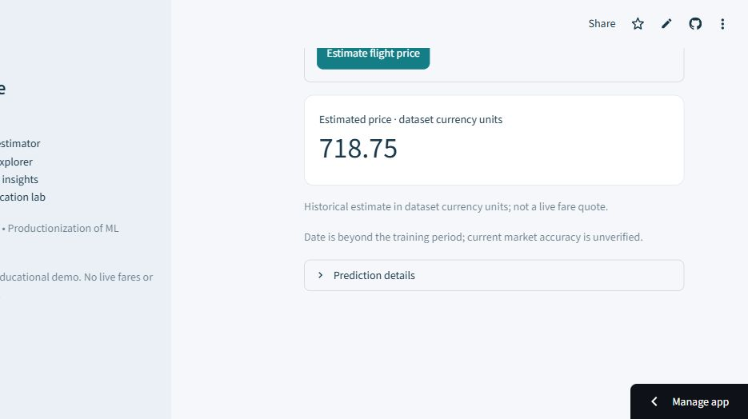
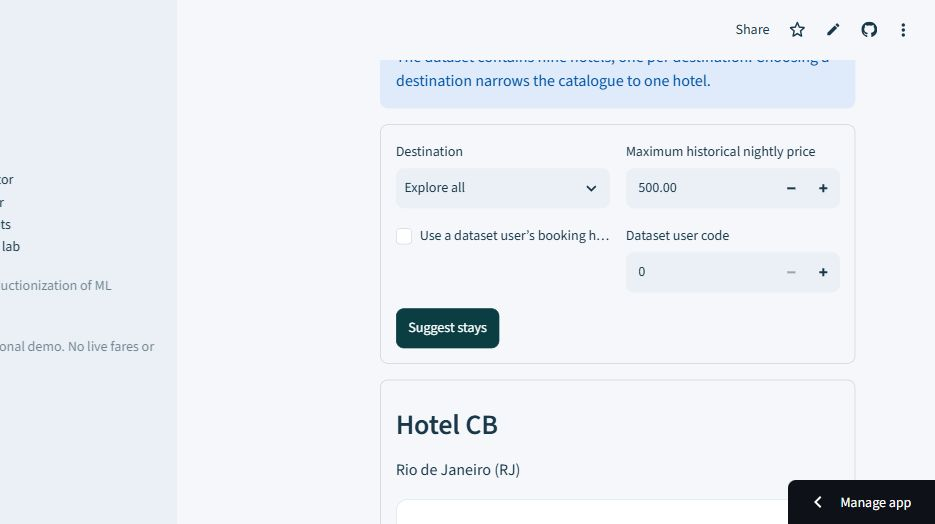
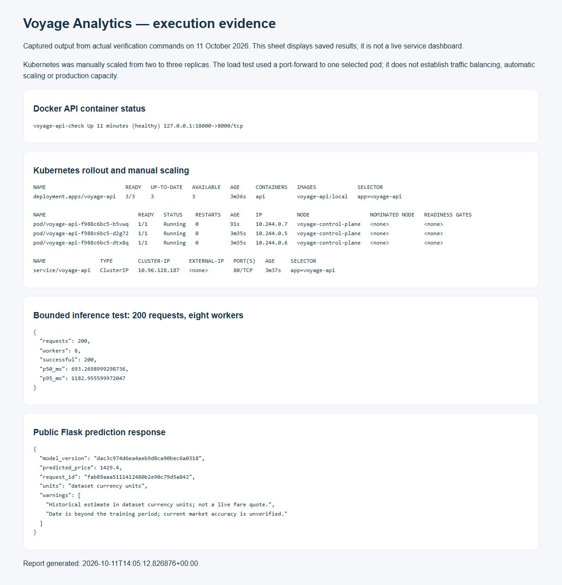
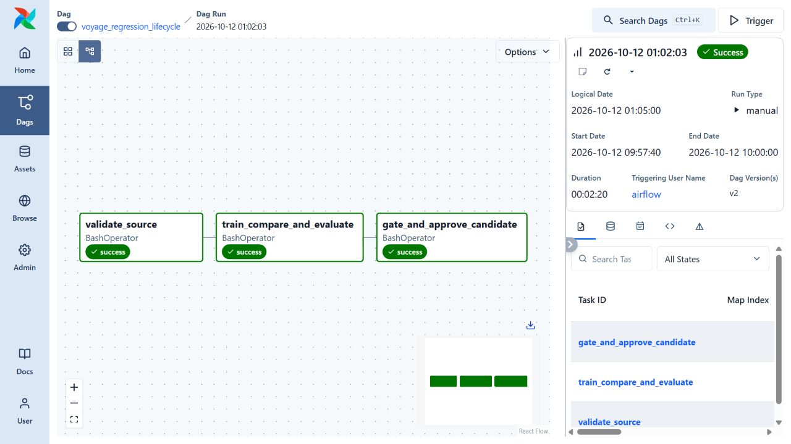
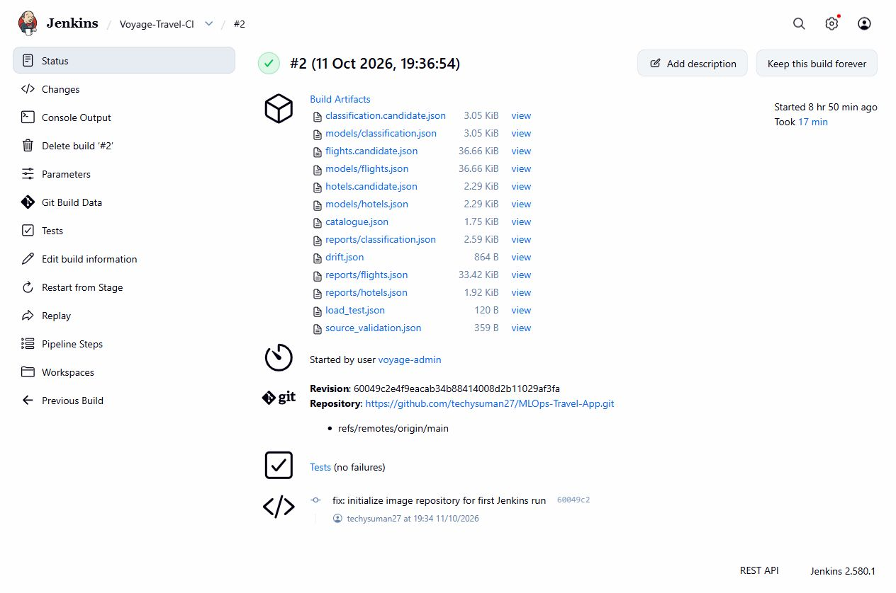
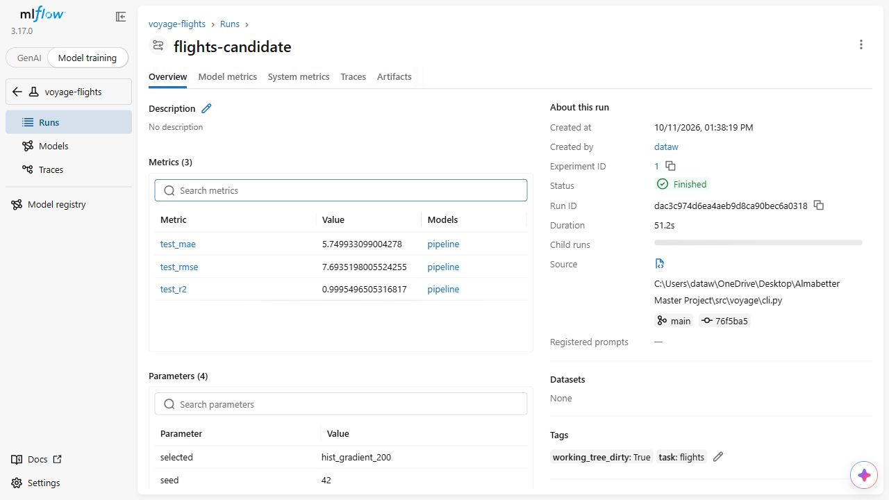

# Voyage Analytics — MLOps workflow narrative

**Author:** techysuman27  
**Course:** AlmaBetter, Productionization of ML Systems  
**Repository:** https://github.com/techysuman27/MLOps-Travel-App

This report explains the implemented workflow and distinguishes verified execution from optional deployment capabilities. Screenshots show this project's actual application, tracking interface and captured execution results.

## 1. Modeling and release preparation

We validate the three course CSV schemas, reject invalid numeric/date values, verify user references and fingerprint the source snapshot. The flight model uses route, cabin, agency, duration, distance and calendar features. Identifiers and price-derived features are excluded. A chronological split reserves later flights for validation and final evaluation; trips crossing split boundaries are purged.

The validation comparison selects histogram gradient boosting with 200 iterations. Final held-out MAE is 5.75, RMSE 7.69 and R-squared 0.99955. These scores describe the constrained historical dataset, not current airline pricing. The course schema does not establish currency, so the application uses dataset currency units.

The complete preprocessing pipeline is persisted together with the estimator. A manifest identifies the run and artifact checksum. The local model gate requires at least a 10% validation RMSE improvement over a median baseline. A failed gate cannot overwrite the currently approved manifest.

## 2. REST API

The Flask application loads approved artifacts at startup. Clients send a JSON flight request; validation checks fields, categories, date and numeric bounds. The shared fitted pipeline transforms inputs and produces a prediction. Responses contain a request ID and model version so predictions can be traced to an artifact.

Liveness means the process can respond. Readiness means all required models loaded successfully. We tested a valid prediction, an invalid request returning HTTP 400, and missing-model readiness returning HTTP 503. The first Docker check caught a missing artifact dependency, demonstrating why readiness matters.

The captured deployment report below includes an actual public API response with its prediction and model version. The full JSON is retained in the repository alongside the screenshot.

## 3. Streamlit application

The interface calls the Flask API rather than training models or duplicating preprocessing. The flight estimator accepts journey details and displays an estimate with its limitations. The hotel explorer supports historical booking preferences and budget filters. The insights page displays measured model results. The classification lab clearly labels its weak predictive value and source-category semantics.

The public application is https://voyage-analytics-suman.streamlit.app/ and calls the Render-hosted API. Public readiness, flight prediction, invalid-request handling and hotel recommendations passed the deployment smoke checks on 2026-10-11.

The hotel dataset contains one hotel per destination. Therefore the UI distinguishes broad catalogue ranking from a destination-filtered lookup and never claims real-time room availability.

## 4. Docker deployment

Separate images package the API and UI. The API uses a production WSGI server, a non-root user and an HTTP readiness check. Model bundles are included with the release so every replica receives the same approved artifacts. The runtime dependency list must include dependencies used by serialized data objects, not just imports visible in the API file.

The rebuilt API image passed readiness, valid flight prediction, invalid-input HTTP 400 and hotel recommendation checks. The initial missing `pyarrow` dependency was fixed and the same runtime requirements deployed successfully to Render.

## 5. Kubernetes deployment and scaling

The Deployment starts two API replicas. A Service directs requests to ready pods. Startup probes allow model initialization; readiness prevents routing to unavailable models; liveness detects an unresponsive process. Resource requests/limits make scheduling and capacity explicit. Rollout history supports reverting to a previous release.

The local kind deployment rolled out with two ready replicas, passed API smoke checks, then scaled manually to three ready replicas. Captured output is in `evidence/kubernetes-rollout.txt`. A bounded test completed 200/200 predictions using eight concurrent workers (p50 693 ms, p95 1183 ms). It used a local port-forward to one selected pod, so it does not prove load balancing or a throughput increase. The optional HPA still requires metrics-server and observed automatic scaling evidence. Manual scaling is not automatic scaling.

## 6. Scheduling with Airflow

The regression DAG validates the source, trains and evaluates candidates, and approves only candidates that pass the gate. Code runs inside tasks, not during DAG parsing. The schedule is weekly, 02:00 UTC on Sundays; catch-up is disabled. Each run writes to a distinct candidate folder. Source data is fixed, so this demonstrates reproducible orchestration rather than a live travel feed.

The manual demonstration run completed all three tasks successfully on 12 October 2026, between 09:57:40 and 10:00:00 IST. The resulting approved candidate is version d00a28571d5e43dca6301d5df6815ab6. An earlier scheduled attempt failed because MLflow resolved a relative source-code path from Airflow's temporary working directory. The fix resolves the installed package path absolutely and gives each task an explicit project working directory. Failed history is retained. The weekly schedule is configured; the successful run shown here was triggered manually.

The live service is not overwritten by this DAG; the candidate remains isolated until a reviewed release. The workflow demonstration uses a separate container-hosted MLflow store from the original modeling experiments.

## 7. CI/CD with Jenkins

The pipeline checks out source, prepares the test environment, executes real tests, builds an image and starts that image to verify a prediction. Explicit parameters control local deployment, registry publishing and Kubernetes deployment. The optional registry/cluster stages expect Jenkins credentials; those credentials have not been configured for this local demonstration. The Kubernetes release stage is designed to use a registry digest and verify rollout and inference.

Jenkins build 2 succeeded at commit 60049c2: 13 tests passed, Docker build completed, and readiness, prediction, invalid-input and recommendation checks passed against the resulting container. Registry publishing and Kubernetes deployment were explicitly skipped in that run. The initial Airflow-to-release handoff is manual selection of an approved candidate; automatic triggering is future work.

Build 3 then succeeded at commit a6c36ef with local deployment enabled. It ran the tests, built the release image, verified the container and deployed a persistent API on localhost:18081. The release passed readiness, flight prediction, invalid-input and recommendation checks. The deployment script preserves the previous local container until the replacement passes; restoration on a failed release is implemented but has not been fault-injected in this demonstration. This verifies Jenkins CI and local CD. Registry publishing and Kubernetes CD remain configured options, not executed stages.

## 8. MLflow tracking and monitoring

MLflow contains separate experiments for flights, classification and hotels, with child candidate runs and final evaluation metrics. It records the dataset hash, Git commit and whether the working tree had uncommitted changes. Complete models/bundles and evaluation reports are logged. Early failed experiment exports remain visible as failed runs; they are not removed to make the history look cleaner.

Request logs record latency, status and request ID. The historical drift report compares feature distributions between training and held-out periods. Drift is not predictive error; accuracy monitoring needs actual subsequent outcomes.

## 9. Limitations and next steps

The classification task has approximately 35% holdout accuracy and is an educational benchmark. The recommendation improvement over popularity is modest and does not prove satisfaction uplift. Public free hosting has cold starts and does not provide a production reliability guarantee. Newer data, clearer field semantics, outcome feedback and a richer hotel catalogue are prerequisites for credible business deployment.

The repository's verification ledger records the scope of each executed check. The student records the regression lifecycle presentation using the accompanying walkthrough; no video recording is included in this report.
